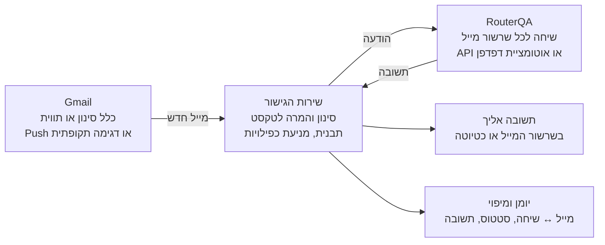

# אפיון: Gmail → RouterQA צ'אט

עודכן: 17 בנובמבר 2026 · [מסמך עריכה חי](https://claude.ai/artifact/1WpZc3eexdc1vNiJB1UY4J)

## מטרה ורקע

אפליקציה ייעודית שמזהה מיילים מסוימים בתיבת ה-Gmail שלך ושולחת את תוכנם כהודעה לצ'אט של אתר RouterQA, ומחזירה את התשובה אליך. במקום להעתיק ידנית מייל לצ'אט, הזרימה רצה לבד.

- **קלט:** מיילים שעונים לכלל סינון (שולח, נושא, תווית Gmail).
- **פעולה:** שליחת גוף המייל (ואופציונלית קבצים מצורפים) כהודעת צ'אט ב-RouterQA.
- **פלט:** תשובת הצ'אט נשמרת בהיסטוריה ונשלחת אליך (כתשובה במייל או כהתראה).

הנחת עבודה: ל-RouterQA יש ממשק צ'אט שאפשר לשלוח אליו הודעות בתוכנה (API או אוטומציית דפדפן). זו ההנחה הקריטית במסמך.

## משתמשים ותרחישי שימוש

משתמש יחיד בשלב הראשון: אתה, עם חשבון Gmail אחד וחשבון RouterQA אחד.

| תרחיש | טריגר | תוצאה צפויה |
| --- | --- | --- |
| שליחה אוטומטית | מייל חדש עונה לכלל סינון | המייל נשלח לצ'אט תוך דקה |
| שליחה ידנית | סימון מייל בתווית `RouterQA` ב-Gmail | המייל נשלח, התווית מתחלפת ל-`RouterQA/sent` |
| קבלת תשובה | הצ'אט מחזיר תשובה | התשובה מגיעה כתשובה בשרשור המייל המקורי |
| מעקב | כניסה למסך הניהול | רשימת מיילים שנשלחו, סטטוס ותשובה |
| שליחה חוזרת | לחיצה על "שלח שוב" במסך הניהול | המייל נשלח שוב לשיחה חדשה או קיימת |

## דרישות פונקציונליות

**א. חיבור חשבונות**

1. התחברות ל-Gmail ב-OAuth 2.0 עם הרשאה מינימלית: `gmail.modify` (קריאה + שינוי תוויות), ו-`gmail.send` רק אם תשובות חוזרות במייל.
2. הגדרת גישה ל-RouterQA: מפתח API או פרטי התחברות, נשמרים מוצפנים.

**ב. כללי סינון — איזה מייל נשלח**

1. כלל מוגדר כשאילתת חיפוש של Gmail, למשל `from:alerts@example.com subject:"דוח"` או `label:RouterQA`.
2. אפשר להגדיר כמה כללים, לכל אחד שם, מתג פעיל/כבוי ויעד שיחה.
3. מייל נשלח פעם אחת בלבד (מזהה הודעה של Gmail נשמר כמפתח ייחודי).

**ג. המרת המייל להודעת צ'אט**

1. חילוץ שולח, נושא, תאריך וגוף כטקסט נקי (HTML מומר לטקסט, בלי חתימות וציטוטים קודמים).
2. תבנית הודעה ניתנת לעריכה לכל כלל, למשל: `נתח את המייל הבא: {subject}\n{body}`.
3. חיתוך טקסט ארוך מהמגבלה של RouterQA, עם סימון שהוא קוצר.
4. קבצים מצורפים: מועברים רק אם RouterQA תומך בהעלאה; אחרת מצוינים בשמם בלבד.

**ד. שליחה לצ'אט וקבלת תשובה**

1. כל שרשור Gmail ממופה לשיחה אחת ב-RouterQA, כך שתשובות המשך נשארות באותו הקשר.
2. המתנה לתשובה עד 60 שניות; תשובה מוזרמת נאספת עד סופה.
3. התשובה נשמרת ונמסרת לפי בחירה: תשובה בשרשור המייל (לעצמך בלבד), טיוטה ב-Gmail, או רק מסך הניהול.
4. בסיום מוצלח המייל מקבל תווית `RouterQA/sent`; בכישלון — `RouterQA/error`.

**ה. מסך ניהול**

- רשימת כללים: הוספה, עריכה, כיבוי, בדיקה יבשה (אילו מיילים היו נתפסים).
- יומן שליחות: תאריך, נושא, כלל, סטטוס, קישור לשיחה, התשובה.
- כפתורים: שלח שוב, השהה הכל (Kill switch).

## ארכיטקטורה וזרימת נתונים

שירות הגישור הוא הרכיב היחיד שבונים: הוא מקבל התראה מ-Gmail, שולח ל-RouterQA, רושם ביומן ומחזיר אליך את התשובה.

| רכיב | טכנולוגיה מוצעת ל-MVP | חלופה מתקדמת |
| --- | --- | --- |
| טריגר | Google Apps Script עם טריגר זמן כל 5 דקות | Gmail API `users.watch` + Cloud Pub/Sub |
| שירות הגישור | בתוך Apps Script | Node.js או Python ב-Cloud Run |
| חיבור ל-RouterQA | `UrlFetchApp` ל-API של RouterQA | Playwright אם אין API |
| יומן ומיפוי | Google Sheet | Firestore או PostgreSQL |
| מסך ניהול | הגיליון עצמו | אפליקציית ווב קטנה |

## אבטחה ופרטיות

האפליקציה נוגעת במייל פרטי, לכן העיקרון הוא להעביר רק את מה שנבחר במפורש.

- **הרשאות מינימליות:** שום הרשאת מחיקה; האפליקציה קוראת רק מיילים שעונים לכלל.
- **סודות:** טוקני OAuth ומפתח RouterQA במנהל סודות (למשל Google Secret Manager), לא בקוד ולא במסד נתונים בטקסט גלוי.
- **שמירת תוכן:** נשמרים מטא-דאטה ותשובה; גוף המייל נמחק אחרי 30 יום.
- **הסתרת מידע רגיש (אופציונלי):** מיסוך מספרי כרטיס, ת"ז וטלפונים לפני שליחה לצ'אט.
- **הזרקת פקודות:** תוכן המייל נעטף בתבנית שמסמנת אותו כנתון לניתוח, לא כהוראה. תשובות מהצ'אט לעולם לא נשלחות לשולח המקורי — רק אליך.
- **תנאי שימוש:** לוודא ש-RouterQA מאפשר גישה אוטומטית; אוטומציית דפדפן עלולה להפר אותם.
- **אימות Google:** אפליקציה פרטית למשתמש אחד נשארת במצב Testing ולא צריכה ביקורת אבטחה; במצב זה טוקן הרענון פג אחרי 7 ימים וצריך להתחבר מחדש (או לפרסם כאפליקציה פנימית ב-Workspace).

## דרישות לא-פונקציונליות

| תחום | יעד |
| --- | --- |
| זמן ממייל לצ'אט | עד 60 שניות (עם Gmail Push); עד 5 דקות בדגימה |
| אמינות | שום מייל תואם לא נאבד ולא נשלח פעמיים |
| ניסיונות חוזרים | 3 ניסיונות עם השהיה גדלה (1, 5, 30 דקות), אחר כך סטטוס שגיאה |
| הגבלת קצב | עד 20 מיילים בשעה לצ'אט (ניתן לשינוי), מעבר לכך ממתין בתור |
| עלות תפעול | בתוך השכבה החינמית של ספק הענן |
| התראות | מייל אליך כשההתחברות נכשלת או כש-3 שליחות רצופות נכשלו |
| שפה | תמיכה מלאה בעברית וב-RTL, כולל קידודים במיילים ישנים (windows-1255) |

## שלבי פיתוח ושאלות פתוחות

1. **MVP:** כלל סינון אחד, דגימה כל 5 דקות, שליחת טקסט לצ'אט, שמירת התשובה ותווית ב-Gmail. אפשר לבנות כ-Google Apps Script בלי שרת.
2. **שלב 2:** מסך ניהול, כמה כללים, תבניות, תשובה במייל.
3. **שלב 3:** Gmail Push בזמן אמת, קבצים מצורפים, מיסוך מידע רגיש.

**שאלות פתוחות**

- [ ] האם ל-RouterQA יש API רשמי לשליחת הודעות, או שצריך אוטומציית דפדפן?
- [ ] מהם כללי הסינון המדויקים — שולח, נושא או תווית?
- [ ] לאן תגיע תשובת הצ'אט — מייל, טיוטה או רק מסך ניהול?
- [ ] האם צריך להעביר קבצים מצורפים כבר ב-MVP?
